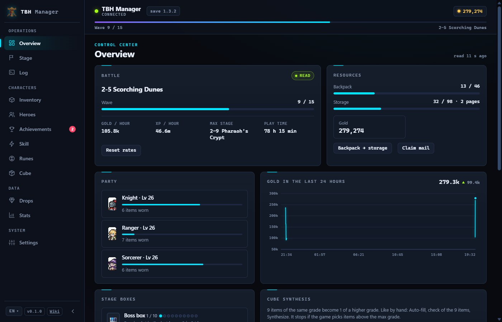
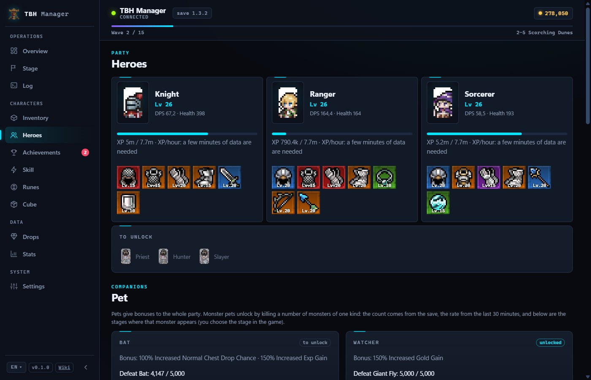
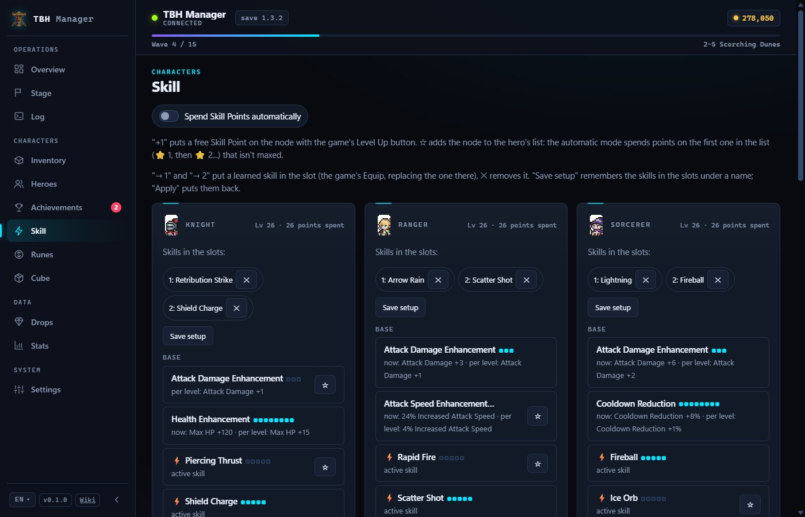
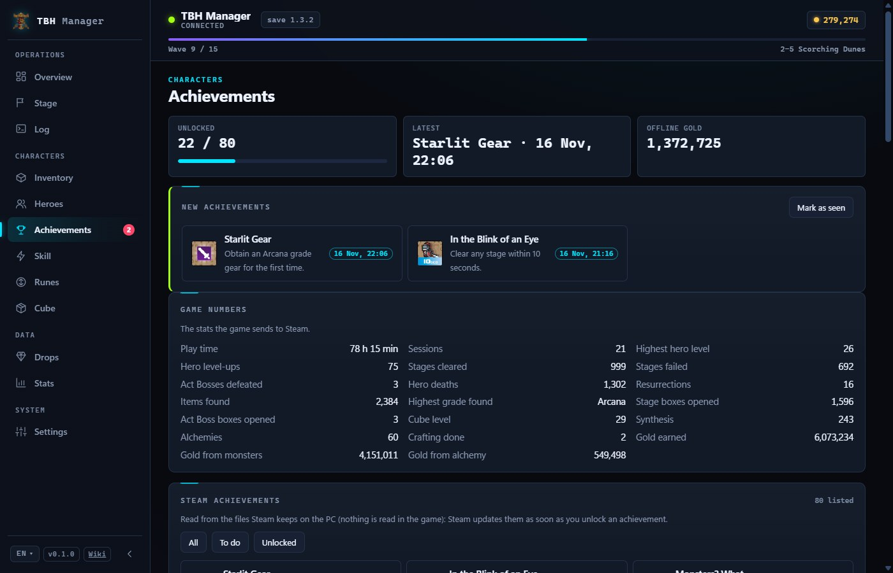

# TBH Manager

**[English](#english) · [Italiano](#italiano) · [中文](#中文)**

<table>
  <tr>
    <td></td>
    <td></td>
    <td></td>
  </tr>
</table>

---

## English

An unofficial companion app for **Task Bar Hero**, for Windows. It runs next to the game, in its own window, and lets
you manage your heroes from a web page, on your PC or on your phone, without looking at the game window.

It reads the live game (gold, stage and wave, heroes, backpack, stash, equipped gear…) and uses the **same functions
as the game's own buttons**: no simulated clicks, no screenshots, no edited values.

**Free for everyone**, no paid version.

**What it does**

- Live view of your stage, heroes (DPS, health, EXP per hour), resources, and gold and boxes per hour
- Stage tab like the game's portal: jump to a stage with Go (Act Bosses too), or pin one so your party is brought back
- Skill Points, skill slots and saved skill setups; Runes: buy them one by one or max out with your gold
- Stage chests, backpack to stash, cube synthesis, alchemy with "keep N" rules, Cube recipes (Extraction, Crafting,
  Decoration, Engraving), "Equip best", claim your mail. Almost everything has an automatic version, off by default
- Charts of gold, hero levels, stage and backpack, a per-stage table, a drop log, your Steam achievements
- Trade Ship slots and the most valuable items to send to Steam
- Telegram alerts (for example when the game stops) and an optional watchdog that reopens the game
- A built-in wiki read from your own game files; the page is in English, Italian and Chinese

**Install**

1. Download **TBHManager-v0.1.0-windows.zip** from the [latest release](https://github.com/ASecretLibrary/TBHManager/releases/latest) and unzip it.
2. Close the game and run **TBHManager-Setup-v0.1.0.exe**. If Windows says "Windows protected your PC", click
   **More info → Run anyway**.
3. Open Task Bar Hero from Steam: TBH Manager finds the game by itself and your data shows up.

The game loads the manager's bridge itself: nothing is injected into the game and nothing in its memory is edited.
This repository only holds the downloads and release notes; the source code is private.

**Help and news:** [join our Discord](https://discord.gg/H24yEwScg5) (channel #tbh-manager).

> ⚠️ **Warning:** TBH Manager is unofficial and not affiliated with the game's developers. It adds a file to the game's
> folder (a bridge DLL; Steam's "Verify integrity of game files" puts the original back) and automates parts of the
> game. This is probably against the game's rules and **may get your account banned: use it at your own risk**.

### Privacy

TBH Manager runs on your PC and reads the game only while both are open. It goes online only for these:

- **Telegram alerts**, only if you set them up: the messages go to your own bot.
- **Steam Market prices**, to show the value of items you can sell: it asks the public Steam page for each item's price.

It never sends your save files, and it has no account or key.

---

## Italiano

Un programma non ufficiale per Windows che affianca **Task Bar Hero**. Gira accanto al gioco, in una finestra sua, e ti
fa gestire gli eroi da una pagina web, sul PC o sul telefono, senza guardare la finestra del gioco.

Legge il gioco dal vivo (oro, stage e onda, eroi, zaino, deposito, equipaggiamento…) e usa le **stesse funzioni dei
bottoni del gioco**: niente clic simulati, niente screenshot, nessun valore modificato.

**Gratis per tutti**, nessuna versione a pagamento.

**Cosa fa**

- Vista dal vivo di stage, eroi (DPS, vita, EXP all'ora), risorse, oro e casse all'ora
- Scheda Stage come il portale del gioco: vai a uno stage con Go (anche gli Act Boss), oppure fissane uno e la squadra
  viene riportata lì
- Punti Skill, skill negli slot e configurazioni salvate; Rune: comprale una alla volta o al massimo con l'oro
- Casse dello stage, zaino nel deposito, sintesi nel cubo, alchimia con regole "quanti tenerne", ricette del Cubo
  (Extraction, Crafting, Decoration, Engraving), "Equipaggia il migliore", riscuoti la posta. Quasi tutto ha anche la
  versione automatica, spenta all'inizio
- Grafici di oro, livelli degli eroi, stage e zaino, tabella per stage, registro dei drop, i tuoi obiettivi di Steam
- Slot della Trade Ship e gli oggetti più preziosi da mandare su Steam
- Avvisi su Telegram (per esempio quando il gioco si ferma) e una sorveglianza che riapre il gioco
- Una wiki integrata letta dai file del tuo gioco; la pagina è in italiano, inglese e cinese

**Come si installa**

1. Scarica **TBHManager-v0.1.0-windows.zip** dall'[ultima versione](https://github.com/ASecretLibrary/TBHManager/releases/latest) e decomprimilo.
2. Chiudi il gioco e avvia **TBHManager-Setup-v0.1.0.exe**. Se Windows dice "Windows ha protetto il PC", clicca
   **Ulteriori informazioni → Esegui comunque**.
3. Apri Task Bar Hero da Steam: TBH Manager trova il gioco da solo e i tuoi dati compaiono.

Il gioco carica da solo il ponte del programma: niente viene iniettato nel gioco e nessun valore in memoria viene
modificato. Questo repository contiene solo i download e le note di versione; il codice è privato.

**Aiuto e novità:** [entra nel nostro Discord](https://discord.gg/H24yEwScg5) (canale #tbh-manager).

> ⚠️ **Attenzione:** TBH Manager non è ufficiale e non è affiliato agli sviluppatori del gioco. Aggiunge un file nella
> cartella del gioco (una DLL ponte; "Verifica l'integrità dei file di gioco" di Steam rimette l'originale) e
> automatizza alcune azioni. Probabilmente è contro le regole del gioco e **può farti bannare l'account: usalo a tuo
> rischio**.

### Privacy

TBH Manager gira sul tuo PC e legge il gioco solo finché sono aperti entrambi. Va online solo per questo:

- **Avvisi Telegram**, solo se li configuri: i messaggi vanno al tuo bot.
- **Prezzi del Mercato di Steam**, per mostrare il valore degli oggetti vendibili: chiede la pagina pubblica di Steam.

Non invia mai i tuoi salvataggi e non ha account né chiavi.

---

## 中文

**Task Bar Hero** 的非官方 Windows 辅助程序。它在游戏旁边用自己的窗口运行，让你在电脑或手机上通过网页管理英雄，
不用一直盯着游戏窗口。

它实时读取游戏数据（金币、关卡和波数、英雄、背包、仓库、装备……），并使用**和游戏按钮相同的功能**：
不模拟点击、不截图、不修改任何数值。

**对所有人免费**，没有付费版本。

**功能**

- 实时查看关卡、英雄（DPS、生命、每小时经验）、资源，以及每小时的金币和宝箱
- 像游戏传送门一样的关卡页：用 Go 前往某个关卡（包括 Act Boss），或固定一个关卡，队伍被移走时会自动带回
- 技能点、技能槽和已保存的技能配置；符文：逐个购买，或用金币一次买到最多
- 关卡宝箱、背包存入仓库、魔方合成、带“保留 N 个”规则的炼金、魔方配方（Extraction、Crafting、Decoration、Engraving）、
  “装备最佳”、领取邮件。几乎所有功能都有自动版本，默认关闭
- 金币、英雄等级、关卡和背包的图表，按关卡统计的表格，掉落记录，你的 Steam 成就
- Trade Ship 栏位，以及最值得发送到 Steam 的物品
- Telegram 提醒（例如游戏停止时）和可选的游戏看门狗（自动重新打开游戏）
- 内置维基，数据读取自你自己的游戏文件；页面支持英语、意大利语和中文

**安装**

1. 从[最新版本](https://github.com/ASecretLibrary/TBHManager/releases/latest)下载 **TBHManager-v0.1.0-windows.zip** 并解压。
2. 关闭游戏，运行 **TBHManager-Setup-v0.1.0.exe**。如果 Windows 提示“Windows 已保护你的电脑”，点击
   **更多信息 → 仍要运行**。
3. 从 Steam 打开 Task Bar Hero：TBH Manager 会自动找到游戏，你的数据随即显示。

游戏会自己加载本程序的桥接文件：不会向游戏注入任何东西，也不会修改内存中的任何数值。
本仓库只提供下载和版本说明，源代码不公开。

**帮助和新闻：** [加入我们的 Discord](https://discord.gg/H24yEwScg5)（频道 #tbh-manager）。

> ⚠️ **警告：** TBH Manager 是非官方程序，与游戏开发者无关。它会在游戏文件夹中添加一个文件（桥接 DLL；
> Steam 的“验证游戏文件完整性”会恢复原文件），并自动执行部分游戏操作。这很可能违反游戏规则，
> **可能导致你的账号被封：使用风险自负**。

### 隐私

TBH Manager 在你的电脑上运行，只在游戏和程序都打开时读取游戏。它只会因以下原因联网：

- **Telegram 提醒**，仅在你设置后：消息发送到你自己的机器人。
- **Steam 市场价格**，用于显示可出售物品的价值：向 Steam 公开页面查询每件物品的价格。

它从不发送你的存档，也没有账号或密钥。
